# Thiết kế Giao diện & Trải nghiệm Người dùng: Chấm công & Quản trị Nhân sự (HRM & Shift Handover)

- **Mã tài liệu**: DES-HRM-01
- **Người thiết kế**: UI/UX Designer Agent (`11sport-designer`)
- **Tài liệu căn cứ**: `docs/requirements/he-thong-cham-cong-hrm.md` (v1.3)
- **Design Tokens**: `docs/design/design-system.md`
- **Trạng thái**: Đã phê duyệt / Bàn giao Dev

---

## 1. Kiến trúc Thông tin & Luồng người dùng (User Flows)

```mermaid
flowchart TD
    subgraph NV_Office["1. Khối Văn phòng (OFFICE)"]
        O1["Đăng nhập"] --> O2{"Có đơn WFH hôm nay?"}
        O2 -- Có --> O3["Chấm công mọi nơi (Lưu GPS thực)"]
        O2 -- Không --> O4["Kiểm tra GPS < 50m & WiFi LAN VP"]
        O4 -- Hợp lệ --> O5["Bấm Check-in (Quy về 08:30)"]
        O5 --> O6["12:00 - 13:30 Tự dừng đếm nghỉ trưa"]
        O6 --> O7["Đủ 17:30: Bấm Check-out"]
    end

    subgraph NV_Sales["2. Khối Bán hàng (SALES)"]
        S1["Đến Showroom (12:00 hoặc 08:30)"] --> S2["Check-in GPS Showroom + WiFi quầy"]
        S2 --> S3["Làm việc tại Showroom"]
        S3 --> S4["Đến giờ hết ca (17:30 hoặc 21:00)"]
        S4 --> S5["Mở màn hình: Bàn giao Kho Tầng 1 & Chốt Két"]
        S5 --> S6{"Là Ca 1 (17:30) hay Ca 2 (21:00)?"}
        S6 -- Ca 1 --> S7["Chờ Ca 2 đã check-in xác nhận"]
        S7 --> S8["Ca 2 duyệt -> Nút Check-out sáng -> Check-out về"]
        S6 -- Ca 2 --> S9["Gửi biên bản Đóng cửa (Store Close) -> Check-out về"]
    end

    subgraph HR_Flow["3. Quản trị Nhân sự (HR trên CMS)"]
        H1["CMS HR Dashboard"] --> H2["Duyệt đơn WFH / Nghỉ phép"]
        H1 --> H3["Bảng Kéo-Thả (Drag & Drop) Xếp ca tuần"]
        H1 --> H4["Quản lý Hồ sơ & Hợp đồng lao động"]
        H1 --> H5["Cấu hình Ngày lễ trên Calendar"]
    end
```



---

## 2. Đặc tả Chi tiết Các Màn hình & Wireframe

### Màn hình 1: Mobile / Web Check-in & Chấm công (Dùng chung Showroom & Văn phòng)
- **Vị trí**: Nút Chấm công trên Header Web & Menu Mobile (`web/` và `cms/`).
- **Bố cục chính**:
  1. **Thẻ Định vị & Kết nối mạng**:
     - Radar quét GPS: Hiển thị khoảng cách thực tế (VD: `Khoảng cách: 15m - Hợp lệ (≤ 50m)` với badge xanh lục `bg-emerald-100 text-emerald-800`).
     - Badge Mạng LAN: `WiFi Showroom: Đã kết nối (192.168.1.100 - Hợp lệ)`.
     - *Nếu là ngày WFH*: Thay thế bằng Banner tím `bg-purple-100 text-purple-800`: *"Hôm nay bạn có lịch Làm việc từ xa (WFH) đã duyệt bởi HR"*.
  2. **Đồng hồ thời gian thực (Live Clock)**: Chữ số lớn `JetBrains Mono font-bold text-4xl text-slate-900`.
  3. **Hiển thị Ca làm việc hôm nay**:
     - Ca 1: `08:30 - 17:30` (Nghỉ trưa `12:00 - 13:30`).
     - Ca 2: `12:00 - 21:00`.
  4. **Nút bấm Hành động khổng lồ (Touch target $\ge 56px$)**:
     - *Chưa Check-in*: Nút to `bg-emerald-600 hover:bg-emerald-700 text-white font-bold py-4 rounded-xl shadow-lg`: **"BẤM CHECK-IN VÀO CA"**.
     - *Đã Check-in*: Hiển thị thời gian vào ca, trạng thái:
       - Nếu bấm sớm lúc `08:05`: Hiển thị *"Check-in lúc 08:05 • Bắt đầu tính công từ 08:30"*.
       - Nếu bấm trễ lúc `08:42`: Badge cam `Đi trễ 12 phút`.
     - *Nút Check-out*:
       - Khối Văn phòng: Sau 17:30 nút chuyển sang đỏ `bg-rose-600 hover:bg-rose-700` sẵn sàng bấm. Nếu bấm trước 17:30 hiện cảnh báo Về sớm.
       - Khối Sales: Bị mờ kèm icon ổ khóa `🔒 Cần hoàn tất bàn giao Kho Tầng 1 và được ca sau xác nhận`.

---

### Màn hình 2: Pop-up Thứ 6 Đăng ký Ca & Lịch bận (Khối Sales)
- **Kích hoạt**: Tự động bật modal khi nhân viên Sales bấm Check-out ca cuối cùng ngày Thứ 6.
- **Tiêu đề**: 🗓️ **Đăng ký Lịch Làm Việc Tuần Tới (Thứ 2 - Chủ Nhật)**
- **Giao diện**:
  - Dạng lưới 7 cột (tương ứng 7 ngày trong tuần).
  - Mỗi ngày gồm 3 nút chọn lựa trực quan (Radio / Pill):
    - `[ ] Ca 1 (08:30 - 17:30)`
    - `[ ] Ca 2 (12:00 - 21:00)`
    - `[X] Xin OFF ngày này` (Tô viền cam, nhập lý do ngắn nếu có).
  - Giới hạn: Cảnh báo nếu số ngày xin OFF vượt quá 2 ngày/tuần.
  - Nút: `[Gửi Đăng Ký Ca Cho HR]` (Bắt buộc gửi mới hoàn tất đóng ca thứ 6).

---

### Màn hình 3: Giao diện Kéo - Thả Xếp Ca cho HR (`Drag & Drop Scheduler` trên CMS)
- **Vị trí**: CMS -> Module Chấm công & Ca kíp -> Tab **Xếp ca Tuần tới**.
- **Bố cục**:
  - **Thanh công cụ**: Chọn tuần (Tuần hiện tại / Tuần kế tiếp), Nút *"Tự động xếp ca thông minh"* (chạy auto-assign theo nguyện vọng T6), Nút *"Chốt & Công bố lịch"*.
  - **Bảng ma trận (Grid Table)**:
    - Trục ngang: 7 ngày (Thứ 2 đến Chủ Nhật).
    - Trục dọc: 2 hàng chính:
      - **Hàng 1: Ca 1 (08:30 - 17:30)** - Chỉ tiêu: Tối thiểu 2 nhân sự / ca.
      - **Hàng 2: Ca 2 (12:00 - 21:00)** - Chỉ tiêu: Tối thiểu 2 nhân sự / ca.
  - **Cột bên phải (Sidebar Kéo-thả - `Unassigned / Conflicts`)**:
    - Danh sách thẻ nhân viên (Avatar + Tên + Badge ca mong muốn / Ngày xin off).
    - Nhân viên bị trùng lịch hoặc chưa đủ ca được tô màu đỏ/vàng cảnh báo.
  - **Tương tác Kéo - Thả**:
    - HR giữ chuột kéo thẻ nhân viên thả vào ô Ca của ngày mong muốn.
    - Hiệu ứng thả mượt mà, tự động cập nhật số lượng nhân sự trực ca.
    - Nếu thả vào ngày nhân viên xin off -> Hiện popup cảnh báo xác nhận *"Nhân viên xin nghỉ ngày này, bạn có chắc chắn muốn phân ca?"*.

---

### Màn hình 4: Màn hình Bàn giao Kho Tầng 1 & Chốt Két (Showroom Sales)
- **Vị trí**: Web POS -> Tab Kết Ca / Bàn giao (`ShiftHandoverModal.tsx`).
- **Giao diện 2 bước tinh gọn**:
  1. **Bước 1: Chốt Két Tiền Mặt**:
     - Tiền đầu ca: `2.000.000 ₫` (hệ thống tự lấy).
     - Doanh thu tiền mặt trong ca: `15.420.000 ₫` (hệ thống tự tính từ hóa đơn).
     - Tổng tiền mặt lý thuyết: `17.420.000 ₫`.
     - Ô nhập: `Tiền mặt thực tế đếm được` -> Hiển thị chênh lệch ngay (màu xanh nếu khớp, màu đỏ nếu lệch).
  2. **Bước 2: Kiểm đếm Kho Tầng 1 (Nguyên tắc Mặc định Khớp)**:
     - Thanh tìm kiếm mã hàng & nút quét barcode súng bắn mã vạch.
     - Tabs phân nhóm: `Tất cả` | `Giày thể thao` | `Vợt & Bóng` | `Quần áo & Phụ kiện`.
     - Danh sách thẻ hàng tồn Tầng 1:
       - Mặc định: Badge xanh `Khớp 100% (Số lượng: X)`.
       - Nếu đếm lệch: Bấm nút `[+]` hoặc `[-]` để sửa số lượng thực tế -> Hệ thống ghi nhận biến động màu cam.
  3. **Hành động**:
     - Nút **"Gửi Bàn Giao Cho Ca Sau"**: Gửi dữ liệu lên máy chủ và kích hoạt trạng thái chờ Ca 2 xác nhận.
     - Màn hình chuyển sang trạng thái chờ: Vòng xoay loading nhẹ + Dòng chữ *"Đang chờ nhân viên ca sau [Nguyễn Văn B] check-in và xác nhận bàn giao để mở khóa Check-out"*.

---

### Màn hình 5: Pop-up Xác nhận Nhận ca (Dành cho Ca Sau)
- **Kích hoạt**: Ngay sau khi nhân viên Ca Sau bấm Check-in thành công.
- **Nội dung pop-up**:
  - Tiêu đề: 📋 **Xác Nhận Bàn Giao Ca Từ [Tên NV Ca Trước]**
  - Tóm tắt:
    - Tiền mặt bàn giao: `17.420.000 ₫` (Khớp).
    - Hàng hóa Kho Tầng 1: `84 mã hàng` (Khớp 84/84).
  - 2 Nút chọn:
    - `[Từ chối / Yêu cầu đếm lại]` (nếu kiểm tra thấy không khớp).
    - `[Đồng ý Nhận Ca]` (Màu xanh Emerald) -> Bấm 1 chạm: Hoàn tất nhận ca & Lập tức mở khóa nút Check-out cho ca trước.

---

### Màn hình 6: Quản lý Hồ sơ Nhân sự & Lịch Lễ trên CMS (Dành cho HR)
- **Quản lý Hồ sơ (`StaffModule.tsx`)**:
  - Thêm các trường: `Phòng ban (Khối Văn phòng / Khối Showroom)`, `Vai trò (ADMIN, HR, ACCOUNTANT, MARKETING, SALES)`, `Loại hợp đồng (Thử việc / Chính thức / Part-time)`, `CCCD/CMND`, `Ngày vào làm`, `Ngày hết hạn HĐ`, `Email`, `SĐT`.
- **Lịch Công ty & Ngày Lễ (`HolidayCalendarModule.tsx`)**:
  - Giao diện Lịch tháng trực quan.
  - Các ngày lễ được tô màu nền đỏ nhạt kèm nhãn tên ngày lễ ở dưới ô ngày (VD: `30/04: Giải phóng miền Nam`, `01/05: Quốc tế Lao động`).
  - HR bấm vào ngày để thêm/sửa ghi chú ngày lễ.

---

## 3. Design Tokens Áp dụng (TailwindCSS)
- **Khối Văn phòng Badge**: `bg-indigo-50 text-indigo-700 border-indigo-200`
- **Khối Sales Badge**: `bg-amber-50 text-amber-700 border-amber-200`
- **WFH Badge**: `bg-purple-50 text-purple-700 border-purple-200`
- **Nút Check-in thành công**: `bg-emerald-600 hover:bg-emerald-700 text-white font-semibold shadow-md active:scale-98`
- **Nút Check-out hợp lệ**: `bg-rose-600 hover:bg-rose-700 text-white font-semibold shadow-md`
- **Nút Check-out bị khóa**: `bg-slate-200 text-slate-400 cursor-not-allowed border border-slate-300`

---

## 4. Phiếu Bàn giao Thiết kế (Designer -> Backend & Frontend Dev)
```markdown
=== PHIẾU BÀN GIAO THIẾT KẾ (DESIGNER -> DEV) ===
- Mã tài liệu: docs/design/hrm-attendance-cms-web.md
- Danh sách 6 màn hình đã đặc tả:
  1. Mobile / Web Check-in (Radar GPS, LAN indicator, Live Clock, WFH Banner, 2 ca chuẩn).
  2. Modal Thứ 6 Đăng ký Ca & Ngày Off cho Sales.
  3. Drag & Drop Xếp ca trực quan cho HR trên CMS.
  4. Màn hình Bàn giao Kho Tầng 1 & Chốt két tiền Showroom.
  5. Pop-up Xác nhận nhận ca 1 chạm cho Ca sau.
  6. Hồ sơ nhân viên & Calendar cấu hình Ngày lễ cho HR.
- Điểm mấu chốt kỹ thuật:
  - Khóa nút Check-out của Ca 1 cho đến khi Ca 2 check-in và ấn Đồng ý nhận ca.
  - Làm tròn mốc tính công: Check-in sớm quy về 08:30 hoặc 12:00.
  - Đồng hồ dừng tự động từ 12:00 đến 13:30 cho khối Văn phòng.
==================================================
```