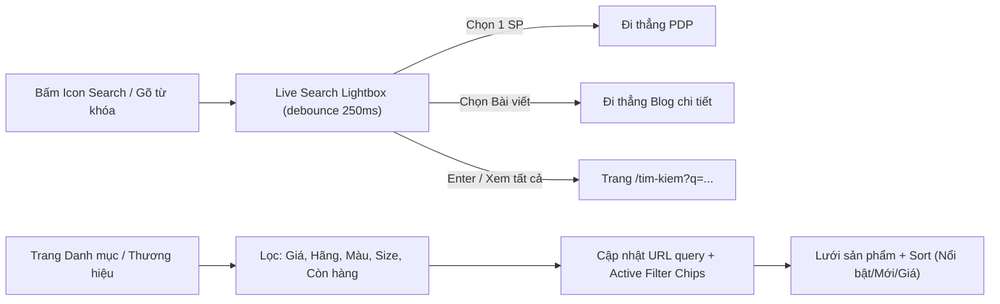
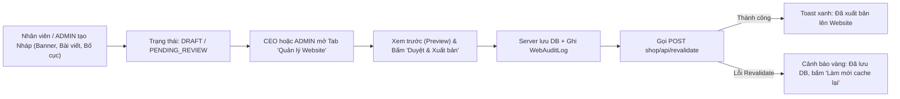

# Đặc tả Luồng & Wireframe — 11 Sport Storefront (`shop/`) & CMS Quản lý Website (`cms/`)

- **Mã tài liệu:** `WEB-03`
- **Phiên bản:** `v1.0`
- **Người lập:** UI/UX Designer (`11sport-designer`)
- **Tham chiếu:** `docs/requirements/web-storefront-v1.md`, `docs/design/storefront-design-system.md`, `docs/design/design-system.md`

---

## 1. User Flow chính

### 1.1 Luồng Mua hàng (Guest & Member) + Thanh toán QR 15 phút
```mermaid
flowchart TD
    A["Trang chủ / Danh mục / Tìm kiếm"] --> B["Chi tiết sản phẩm (PDP)"]
    B --> C{"Chọn Màu (Swatch) & Size"}
    C -->|Hết hàng biến thể| C1["Disable size / Nút 'Tạm hết hàng'"]
    C -->|Còn hàng| D{"Hành động"}
    D -->|Thêm vào giỏ| E["Mở Mini-Cart Drawer / Toast"]
    D -->|Mua ngay| F["Trang Thanh toán (/checkout)"]
    E --> F
    F --> G{"Guest hay Member?"}
    G -->|Member (Email OTP)| H["Tự điền Sổ địa chỉ mặc định"]
    G -->|Guest| I["Nhập Tên, SĐT, Địa chỉ nhận hàng"]
    H --> J["Áp Coupon + Chọn 1 Quà tặng hợp lệ (không lặp)"]
    I --> J
    J --> K{"Phương thức thanh toán"}
    K -->|COD| L["Server trừ kho atomic -> Tạo đơn"]
    K -->|PayOS / VietQR| M["Giữ kho 15p -> Hiện QR + Countdown 14:59"]
    M -->|Webhook PAID| L2["Xác nhận PAID -> Chuyển /order-success"]
    M -->|Quá 15p| N["Hết hạn QR -> Hoàn kho -> Nút 'Đặt lại đơn'"]
    L --> O["Trang Đặt hàng thành công (/order-success)"]
    L2 --> O
```

### 1.2 Luồng Tìm kiếm & Lọc danh mục


### 1.3 Luồng Duyệt nội dung CEO / ADMIN trên CMS & Revalidate


---

## 2. Wireframe & Spec Storefront (`shop/`)

### 2.1 Trang chủ (`/`)

#### Bố cục Desktop (`>= 1024px`)
```text
+-------------------------------------------------------------------------+
| TOP BAR (#064E3B): Freeship đơn từ 500k | Hotline: 09xx.xxx.xxx          |
+-------------------------------------------------------------------------+
| [LOGO 11SPORT]   Vợt | Giày | Thời trang | Balo | Phụ kiện | Tin tức    |
|                                              [Search] [Account] [Cart(2)]|
+-------------------------------------------------------------------------+
| HERO SLIDER (1440x520, Embla Carousel, ảnh riêng desktop)               |
|  [<]                                                                [>] |
|                          ● ○ ○ ○                                        |
+-------------------------------------------------------------------------+
| 4 USP CAM KẾT: [Chính hãng 100%] [Đổi trả 7 ngày] [Ship 24h] [Tư vấn Pro]|
+-------------------------------------------------------------------------+
| ⚡ FLASH SALE   Kết thúc sau: [02] : [14] : [35]        [Xem tất cả ->] |
| [ProductCard] [ProductCard] [ProductCard] [ProductCard] [ProductCard]   |
+-------------------------------------------------------------------------+
| KHỐI DANH MỤC 1: VỢT PICKLEBALL (Lưới 5 cột desktop)    [Xem tất cả ->] |
| [Card] [Card] [Card] [Card] [Card]                                      |
| [Card] [Card] [Card] [Card] [Card]                                      |
+-------------------------------------------------------------------------+
| [BANNER XEN KẼ FULL-WIDTH - 1280x280]                                   |
+-------------------------------------------------------------------------+
| KHỐI DANH MỤC 2: GIÀY & THỜI TRANG (Carousel 4-5 cột)   [<] [>]        |
| [Card] [Card] [Card] [Card] [Card]                                      |
+-------------------------------------------------------------------------+
| THƯƠNG HIỆU ĐỐI TÁC & CHỨNG NHẬN ĐẠI LÝ CHÍNH HÃNG (Carousel Logo)     |
+-------------------------------------------------------------------------+
| TIN TỨC & HƯỚNG DẪN CHỌN ĐỒ (3 cột Desktop)            [Xem thêm ->]   |
+-------------------------------------------------------------------------+
| FOOTER 4 CỘT: [Showroom 3 chi nhánh] [Sản phẩm] [Chính sách] [Kết nối]  |
+-------------------------------------------------------------------------+
                                                  [Floating Chat Widget]
```

#### Spec Responsive 3 mốc
- **Mobile (`< 768px`):** Header `60px` (`[☰]` `[Logo]` `[🔍]` `[🛒]`). Hero dùng ảnh tỷ lệ `1:1` hoặc `4:3` riêng. 4 USP xếp lưới `2x2`. Flash Sale & Khối danh mục dạng lưới `2 cột` hoặc vuốt ngang (`1.6 card` lộ mép để gợi ý vuốt). Tin tức `1 cột` hoặc carousel ngang. Footer chuyển thành **Accordion** thu gọn từng cột. Floating Widget thu gọn 1 nút tròn `bottom-5 right-4`.
- **Tablet (`768px – 1023px`):** Lưới sản phẩm `3 cột`, USP `4 cột` gọn, Tin tức `2 cột`, Footer `2x2`.
- **Desktop (`>= 1024px`):** `max-w-7xl`, Lưới `4–5 cột`, Mega Menu 3–4 cột khi hover.

#### 5 Trạng thái bắt buộc
- **Loading:** Skeleton cho Hero (`aspect-[16/6]` desktop / `aspect-square` mobile), 4 ô USP, và 5 `ProductCard` skeleton.
- **Rỗng:** Section nào chưa có sản phẩm/bài viết trong CMS sẽ tự ẩn section đó (không hiện khung trống).
- **Lỗi:** Nếu lỗi tải một section phụ -> hiện banner nhỏ `Không thể tải khối sản phẩm [Thử lại]`, không làm trắng cả trang.
- **Hết hàng:** `ProductCard` hiện pill `Tạm hết hàng` giữa ảnh, vẫn xem được chi tiết.
- **Thành công:** Hiển thị đầy đủ, `<h1>` duy nhất đặt ở tiêu đề Hero hoặc tiêu đề giới thiệu chính (ẩn trực quan `sr-only` nếu Hero là ảnh banner thuần, hoặc render text `<h1>` rõ nét trên Hero).

---

### 2.2 Danh mục cha (Brand Hub) & Danh mục con (`/danh-muc/[slug]`, `/thuong-hieu/[slug]`)

#### Bố cục Desktop (`>= 1024px`)
```text
+-------------------------------------------------------------------------+
| Breadcrumb: Trang chủ / Vợt Pickleball / Joola                          |
| <h1> Vợt Pickleball Joola Chính Hãng (48 sản phẩm)                      |
+-------------------------------------------------------------------------+
| [BRAND HUB - Nếu là danh mục cha: Hàng card Logo Thương hiệu / Danh mục con]|
+-------------------------------------------------------------------------+
| SIDEBAR LỌC (260px) | [Active Chips: Joola × | 1tr-3tr × | Xóa tất cả]  |
| - Khoảng giá        | [Sắp xếp: Nổi bật v]                              |
|   [Từ] - [Đến]      | +--------+ +--------+ +--------+ +--------+       |
| - Thương hiệu [✓]   | | Card 1 | | Card 2 | | Card 3 | | Card 4 |       |
| - Màu sắc (Swatch)  | +--------+ +--------+ +--------+ +--------+       |
| - Size (S/M/L/XL)   | +--------+ +--------+ +--------+ +--------+       |
| - [✓] Chỉ hiện còn  | | Card 5 | | Card 6 | | Card 7 | | Card 8 |       |
|                     | +--------+ +--------+ +--------+ +--------+       |
|                     |                [ Phân trang: < 1 2 3 > ]          |
+---------------------+---------------------------------------------------+
| MÔ TẢ SEO DANH MỤC (Giới hạn chiều cao 220px + Gradient trắng nhẹ)      |
| ...Nội dung hướng dẫn chọn vợt...                     [Xem thêm v]      |
+-------------------------------------------------------------------------+
```

#### Spec Responsive 3 mốc
- **Mobile (`< 768px`):** Ẩn Sidebar trái. Hiển thị thanh công cụ sticky dưới header gồm 2 nút `44px`: `[Bộ lọc (2)]` và `[Sắp xếp v]`. Bấm `Bộ lọc` mở Drawer full-height có nút `[Xóa lọc]` và `[Xem 48 sản phẩm]`. Lưới sản phẩm `2 cột`.
- **Tablet (`768px – 1023px`):** Dùng thanh công cụ `Bộ lọc` (Drawer cạnh trái `320px`) + Lưới `3 cột`.
- **Desktop (`>= 1024px`):** Sidebar trái cố định `260px` + Lưới `4 cột`.

#### 5 Trạng thái bắt buộc
- **Loading:** Skeleton `8 ProductCard` + skeleton filter.
- **Rỗng (không khớp bộ lọc):** Icon kính lúp + `"Không tìm thấy sản phẩm phù hợp với bộ lọc"` + nút `[Xóa toàn bộ bộ lọc]`.
- **Lỗi:** Khối báo lỗi tải danh sách + nút `[Thử lại]`.
- **Hết hàng:** Sản phẩm hết hàng đẩy xuống cuối (khi sort mặc định) hoặc gắn nhãn `Tạm hết hàng`.
- **Thành công:** Cập nhật URL query (`?brand=joola&minPrice=1000000`) mượt mà, giữ thẻ `canonical` trỏ về URL gốc danh mục.

---

### 2.3 Chi tiết sản phẩm — PDP (`/san-pham/[slug]`)

#### Bố cục Desktop (`>= 1024px`)
```text
+-------------------------------------------------------------------------+
| Breadcrumb: Trang chủ / Vợt Pickleball / Vợt Joola Perseus 16mm         |
+----------------------------------+--------------------------------------+
| GALLERY ẢNH (50%)                | THÔNG TIN & MUA HÀNG (50%)           |
| +------------------------------+ | Thương hiệu: JOOLA | ★ 4.9 (28)      |
| |                              | | <h1> Vợt Pickleball Joola Perseus    |
| |   Ảnh chính (Zoom on hover/  | | SKU: 11S-JOOLA-01 | Còn 5 sản phẩm   |
| |   click Lightbox)            | | 4.290.000 ₫  ~~5.100.000 ₫~~ [-16%]  |
| +------------------------------+ | +----------------------------------+ |
| [Thumb1] [Thumb2] [Thumb3] [+]   | | 🎁 ƯU ĐÃI & MUA NHIỀU:           | |
|                                  | | • Mua từ 2 cái giảm thêm 5%      | |
|                                  | | • Tặng kèm 1 Quấn cán chính hãng | |
|                                  | +----------------------------------+ |
|                                  | Màu sắc: Đen/Đỏ                      |
|                                  | [● Đen/Đỏ] [● Xanh] [● Trắng]        |
|                                  | Kích thước / Trọng lượng:            |
|                                  | [14mm] [16mm (Selected)] [16mm Pro]  |
|                                  | Số lượng: [-] [ 1 ] [+]              |
|                                  | [  THÊM VÀO GIỎ  ] [   MUA NGAY   ]  |
|                                  | Chính sách: ✓ Chính hãng ✓ Đổi 7 ngày|
+----------------------------------+--------------------------------------+
| TABS / KHỐI DỌC: [Mô tả chi tiết ("Xem thêm")] | [Bảng thông số kỹ thuật]|
+-------------------------------------------------------------------------+
| ĐÁNH GIÁ SẢN PHẨM (4.9/5 ★) — Bộ lọc: [Tất cả] [5★] [4★] [Có ảnh]      |
| [Danh sách Review có badge "✓ Đã mua hàng"]  +  [Nút Viết đánh giá]     |
+-------------------------------------------------------------------------+
| SẢN PHẨM TƯƠNG TỰ (Carousel 4-5 cột)                                    |
+-------------------------------------------------------------------------+
```

#### Spec Responsive 3 mốc
- **Mobile (`< 768px`):** Xếp 1 cột dọc: Gallery vuốt ngang (hiển thị `1/5` góc ảnh) -> Tiêu đề `<h1>` -> Giá -> Khung ưu đãi -> Swatch màu (`44x44px`) -> Size chip (`min-h-[44px]`). **Sticky Bottom Bar** cố định đáy: `[Thêm vào giỏ]` + `[Mua ngay]`. Trang có `pb-24` để không bị Sticky Bar che nội dung; Floating Chat Widget đẩy lên `bottom-[88px]`.
- **Tablet (`768px – 1023px`):** 2 cột `45% / 55%` hoặc 1 cột tùy chiều rộng; nút CTA hiển thị trực tiếp trong trang.
- **Desktop (`>= 1024px`):** 2 cột `50% / 50%`, hỗ trợ zoom ảnh khi hover/click mở Lightbox.

#### 5 Trạng thái bắt buộc
- **Loading:** Skeleton khung ảnh vuông + các dòng chữ + nút bấm.
- **Rỗng (chưa có đánh giá):** Hiện `"Chưa có đánh giá nào. Hãy là người đầu tiên chia sẻ cảm nhận!"`.
- **Lỗi (sản phẩm không tồn tại/ẩn):** Trang 404 thân thiện + gợi ý sản phẩm nổi bật.
- **Hết hàng biến thể:** Chip size hết hàng bị gạch chéo mờ (`opacity-50 cursor-not-allowed`), khi chọn vào thì 2 nút mua đổi thành `[Tạm hết hàng]` (disabled) và hiện thông báo `"Biến thể này tạm hết, vui lòng chọn màu/size khác"`.
- **Thành công:** Bấm "Thêm vào giỏ" -> cập nhật badge giỏ + mở Mini-Cart Drawer; bấm "Mua ngay" -> đi thẳng `/checkout`.

---

### 2.4 Giỏ hàng (`/gio-hang`), Mini-Cart Drawer, Checkout (`/checkout`) & Order Success

#### Bố cục Checkout 2 Cột Desktop (`>= 1024px`)
```text
+------------------------------------------+------------------------------+
| THÔNG TIN GIAO HÀNG (60%)                | TÓM TẮT ĐƠN HÀNG (40%)       |
| [Nếu chưa login: Đã có tài khoản?        | [Item 1: Ảnh | Tên | x1 | Giá] |
|  Đăng nhập OTP để tự điền địa chỉ ->]    | [Item 2: Ảnh | Tên | x2 | Giá] |
|                                          | +--------------------------+ |
| 1. Người nhận:                           | | 🎁 QUÀ TẶNG ĐƠN HÀNG     | |
|    [Họ và tên *]  [Số điện thoại *]      | | (Chỉ 1 block, chọn 1 quà)  | |
|    [Email (nhận thông tin đơn)]          | | (•) Quấn cán Joola        | |
| 2. Địa chỉ nhận hàng:                    | | ( ) Túi rút 11 Sport       | |
|    [Tỉnh/TP v] [Quận/Huyện v] [Phường v] | +--------------------------+ |
|    [Địa chỉ chi tiết (Số nhà, đường) *]  | Mã ưu đãi: [SALE11] [Áp dụng]|
|    [Ghi chú giao hàng]                   | Tạm tính:         4.290.000₫ |
| 3. Phương thức thanh toán:               | Giảm giá coupon:   -200.000₫ |
|    (•) Chuyển khoản QR (PayOS/VietQR)    | Phí vận chuyển:     Miễn phí |
|    ( ) Thanh toán khi nhận hàng (COD)    | TỔNG CỘNG:        4.090.000₫ |
|                                          | [    HOÀN TẤT ĐẶT HÀNG     ] |
+------------------------------------------+------------------------------+
```

#### Màn hình Chờ thanh toán QR (Modal / Trang trạng thái sau khi bấm Đặt hàng QR)
- Hiển thị mã QR động (`240x240px`), số tiền (`font-mono`), nội dung chuyển khoản + nút `[Sao chép]`, đồng hồ đếm ngược **`14:59`** (`text-[#DC2626] font-mono font-bold`).
- Trạng thái tự động polling/SSE mỗi 3 giây.
  - **Thành công:** Chuyển hướng `/order-success?code=ONL-...`.
  - **Hết hạn 15 phút:** Hiện màn hình `"Mã QR đã hết hạn (giữ chỗ đã được hoàn lại)"` + nút `[Tạo lại đơn / Quay về giỏ hàng]`.
  - **Lỗi `409 Conflict` (hết hàng phút chót):** Banner đỏ liệt kê đúng sản phẩm vừa hết tồn kho để khách điều chỉnh số lượng.

#### Spec Responsive 3 mốc
- **Mobile (`< 768px`):** Checkout xếp 1 cột: Tóm tắt đơn hàng thu gọn thành Accordion trên cùng (`Xem chi tiết đơn hàng (2) — 4.090.000₫`) -> Form giao hàng -> Quà tặng -> Coupon -> Thanh toán -> Nút `[Hoàn tất đặt hàng]` cố định đáy (`min-h-[48px]`).
- **Tablet & Desktop:** Bố cục 2 cột `60% / 40%` (cột phải `sticky top-24`).

---

### 2.5 Tìm kiếm (`/tim-kiem`) & Tài khoản khách (`/tai-khoan`)

- **Tìm kiếm (`/tim-kiem?q=...`):**
  - `<h1> Kết quả tìm kiếm cho "Joola" (24 sản phẩm, 3 bài viết)</h1>`
  - 2 Tab chuyển đổi: `[Sản phẩm (24)]` | `[Bài viết & Hướng dẫn (3)]`.
  - Hỗ trợ bộ lọc & sắp xếp giống trang Danh mục.
  - Trạng thái rỗng: Gợi ý từ khóa phổ biến (`Vợt Pickleball`, `Giày Asics`, `Balo`).
- **Tài khoản khách (`/tai-khoan`):**
  - **Chưa đăng nhập:** Form nhập Email -> Bấm `[Gửi mã OTP 6 số]` -> Nhập 6 ô OTP (có đếm ngược gửi lại `60s`, giới hạn số lần nhập sai).
  - **Đã đăng nhập:** Sidebar 3 mục (trên Mobile là Tab ngang):
    1. **Lịch sử đơn hàng:** Danh sách đơn (Mã đơn `font-mono`, ngày, tổng tiền, badge trạng thái `Chờ xác nhận / Đang giao / Hoàn thành / Đã hủy`, nút `Xem chi tiết`).
    2. **Sổ địa chỉ:** Danh sách địa chỉ đã lưu, gắn nhãn `Mặc định`, nút `+ Thêm địa chỉ mới`, Sửa/Xóa.
    3. **Thông tin cá nhân & Đăng xuất.**

---

### 2.6 Blog (`/tin-tuc`, `/tin-tuc/[slug]`) & Trang tĩnh / Liên hệ (`/[staticSlug]`)

- **Danh sách Blog (`/tin-tuc`):**
  - `<h1> Tin tức & Kiến thức Thể thao 11 Sport</h1>`
  - Bộ lọc Category ngang (`Tất cả`, `Hướng dẫn chọn vợt`, `Kỹ thuật chơi`, `Tin khuyến mãi`).
  - Lưới bài viết: `1 cột` (Mobile), `2 cột` (Tablet), `3 cột` (Desktop).
- **Chi tiết bài viết (`/tin-tuc/[slug]`):**
  - Cột chính (`max-w-[740px]`): `<h1> Tiêu đề bài viết`, Ngày đăng/Tác giả, **Mục lục (Table of Contents)** tự động sinh từ `<h2>`/`<h3>` (thu gọn mặc định trên Mobile), nội dung bài viết.
  - Cột phải Desktop (`320px`): **Sản phẩm liên quan** + **Form tư vấn nhanh** (Tên, SĐT, Nhu cầu -> gửi về CMS).
- **Trang Liên hệ & Hệ thống Showroom (`/lien-he`):**
  - `<h1> Hệ thống Cửa hàng & Liên hệ 11 Sport</h1>`
  - Lưới **3 Card Chi nhánh / Bản đồ** (3 cột Desktop, 1 cột Mobile): Tên chi nhánh, Địa chỉ, Giờ mở cửa, Hotline bấm gọi trực tiếp, nút `[Chỉ đường Google Maps]` + Embed bản đồ.
  - Form liên hệ bên dưới.

---

## 3. Wireframe CMS — Tab "Quản lý Website" (`cms/`)

> **Kế thừa Design System `cms/` (`docs/design/design-system.md`):** Nền trắng `#FFFFFF`, bề mặt phụ `#F8FAFC`, màu chủ đạo **Executive Teal (`#0D9488` / `#0F766E`)**, font `Be Vietnam Pro` + `JetBrains Mono`.

### 3.1 Thanh điều hướng & Phân quyền hiển thị (`ADMIN` vs `CEO` vs `SALES`)

```text
+-------------------------------------------------------------------------+
| [LOGO 11 SPORT CMS]   Dashboard | Kho | Bán hàng | [Quản lý Website *]  |
|                                               [Role Badge: CEO / ADMIN] |
+-------------------------------------------------------------------------+
* Ghi chú RBAC:
  - SALES / Nhân viên khác: ẨN HOÀN TOÀN tab "Quản lý Website".
  - ADMIN: Thấy toàn bộ 12 sub-tab, toàn quyền Sửa / Lưu / Xuất bản / Cấu hình.
  - CEO: Thấy toàn bộ 12 sub-tab, được Duyệt/Xuất bản nội dung, NHƯNG bị khóa
    các nút Sửa cấu hình kỹ thuật (hiển thị icon ổ khóa + disabled).
```

### 3.2 Cấu trúc Layout chung của Tab "Quản lý Website"
- **Bên trái:** Sub-navigation dọc (`w-[240px]` trên Desktop, Drawer trên Mobile/Tablet) chia 3 nhóm:
  - *Tổng quan & Báo cáo:* `1. Dashboard CEO`, `11. Đơn hàng Online`, `12. Nhật ký thao tác (Audit Log)`
  - *Giao diện & Nội dung:* `2. Bố cục trang chủ`, `3. Banner / Slider`, `4. Mega Menu`, `5. SP / Danh mục / Thương hiệu Web`, `6. Bài viết & Trang tĩnh`, `8. Duyệt Đánh giá`
  - *Tăng trưởng & Hệ thống:* `7. Khuyến mãi Online`, `9. SEO & 301 Redirect`, `10. Cài đặt Site`
- **Thanh Top Action cố định trên vùng nội dung:**
  - Tiêu đề Sub-tab + Nút `[Làm mới Cache Website (Revalidate)]` (màu Teal `#0D9488`).

### 3.3 Wireframe chi tiết các Sub-tab trọng tâm

#### Sub-tab 1: Dashboard CEO
- **4 KPI Cards:** Doanh thu Online (tháng), Số đơn Online & Tỷ lệ thành công QR, Tỷ lệ chuyển đổi (GA4), Đánh giá chờ duyệt.
- **Biểu đồ:** Doanh thu Online 30 ngày (so sánh QR vs COD) + Bảng **Top 10 sản phẩm bán chạy Online**.
- **Widget nhanh:** 5 thao tác gần nhất từ `Audit Log`.

#### Sub-tab 2: Bố cục trang chủ (Kéo-thả)
- Danh sách các Section (`Hero Slider`, `4 USP`, `Flash Sale`, `Khối Vợt`, `Banner giữa`, `Khối Giày`, `Thương hiệu`, `Tin tức`).
- Mỗi dòng có: `[Icon kéo thả ⋮⋮]` | `Tên Section` | `Loại hiển thị (Lưới / Carousel)` | `Toggle Bật/Tắt` | `[Cấu hình]`.
- Nút `[Lưu & Xuất bản trang chủ]`.

#### Sub-tab 3 & 4: Banner/Slider & Mega Menu
- **Banner/Slider:** Bảng danh sách kèm thumbnail Desktop & Mobile, cột `Vị trí`, `Lịch hiển thị (Từ ngày - Đến ngày)`, `Trạng thái`. Modal tạo/sửa bắt buộc tải **2 ảnh riêng (Desktop 1440x520 & Mobile 750x750)**.
- **Mega Menu:** Cây phân cấp 2–3 tầng có nút `[+ Thêm mục con]`, chọn `Badge (HOT/MỚI)`, kéo thả đổi thứ tự.

#### Sub-tab 5, 6, 7, 8: Nội dung Web, Blog, Khuyến mãi & Đánh giá
- **SP/Danh mục/Thương hiệu Web:** Bảng đồng bộ từ kho POS, cột `Tồn kho Floor 1` (read-only), Toggle `Hiển thị Online`, nút `[Sửa thông tin Web]` (Ảnh, Swatch ảnh từng biến thể, Mô tả HTML, Thông số kỹ thuật, SEO).
- **Bài viết & Trang tĩnh:** Danh sách có bộ lọc trạng thái `DRAFT / PENDING_REVIEW / PUBLISHED`. Nút `[Duyệt & Xuất bản]` nổi bật màu Teal cho `CEO` & `ADMIN`.
- **Khuyến mãi Online:** 4 Tab nhỏ: `Coupon`, `Mua nhiều giảm giá (Tier Pricing)`, `Flash Sale`, `Quà tặng kèm đơn`.
- **Duyệt Đánh giá:** Bảng review mới (`PENDING`), hiện sao, nội dung, ảnh khách gửi, nhãn `✓ Đã mua hàng`, nút `[Duyệt]` / `[Từ chối]`.

#### Sub-tab 9: SEO & 301 Redirect (Có thanh đếm ký tự)
```text
+-------------------------------------------------------------------------+
| [Tab: SEO Thực thể]  [Tab: Quản lý 301 Redirect]  [Sitemap Status]      |
+-------------------------------------------------------------------------+
| Form chỉnh sửa SEO (cho SP / Danh mục / Bài viết):                      |
| SEO Title: [Vợt Pickleball Joola Perseus 16mm Chính Hãng - 11 Sport   ] |
|            [████████████████████████████░░░░] 56 / 60 ký tự (Đạt chuẩn) |
|                                                                         |
| Meta Desc: [Mua vợt Pickleball Joola Perseus 16mm chính hãng tại 11...] |
|            [█████████████████████████████████░] 155 / 160 ký tự (Tốt)   |
| * Màu thanh đếm: Xám (< tối thiểu) | Xanh (#10B981: 50-60 / 150-160)   |
|                  Đỏ (#EF4444: vượt quá 60 / 160 ký tự)                  |
+-------------------------------------------------------------------------+
| Bảng 301 Redirect: [Từ đường dẫn (/sp-cu)] -> [Đến (/sp-moi)] | [301]   |
+-------------------------------------------------------------------------+
```

#### Sub-tab 10, 11, 12: Cài đặt Site, Đơn hàng Online & Audit Log
- **Cài đặt Site:** Logo, Hotline, Zalo, Messenger, 3 Showroom Footer, Bảng phí ship, Chế độ trừ kho (`FLOOR_1` / `ALL`), **Cấu hình Payment Keys / Webhook Secret / GA4 ID**.
- **Đơn hàng Online:** Bảng lọc theo `Trạng thái thanh toán (PAID/UNPAID/EXPIRED)` và `Trạng thái giao (PENDING/CONFIRMED/SHIPPING/DELIVERED/CANCELLED)`, cập nhật mã vận đơn.
- **Nhật ký thao tác (Audit Log):** Bảng read-only ghi rõ `Thời gian`, `Người thực hiện (Role)`, `Hành động`, `Đối tượng`, `Chi tiết thay đổi (Diff)`.

### 3.4 Ma trận trạng thái hiển thị `ADMIN` vs `CEO` trên CMS

| Chức năng / Nút thao tác | `ADMIN` | `CEO` |
|---|---|---|
| Xem toàn bộ 12 Sub-tab & Dashboard CEO | ✅ Đầy đủ | ✅ Đầy đủ |
| Sửa/Lưu Bố cục trang chủ, Banner, Menu, Bài viết | ✅ Cho phép | ✅ Cho phép |
| Bấm nút **"Duyệt & Xuất bản"** (Bài viết, Banner, Đánh giá) | ✅ Cho phép | ✅ Cho phép |
| Bấm nút **"Làm mới Cache Website (Revalidate)"** | ✅ Cho phép | ✅ Cho phép |
| Sửa Payment Keys, Webhook Secret, GA4/GTM, Chế độ kho | ✅ Cho phép | 🔒 **Khóa (`disabled` + Icon ổ khóa + Tooltip "Chỉ ADMIN được sửa cấu hình kỹ thuật")** |
| Tạo/Xóa `301 Redirect` hệ thống | ✅ Cho phép | 🔒 **Chỉ xem (ẩn nút Thêm/Xóa)** |
| Quản lý Nhân viên / Phân quyền | ✅ Cho phép | 🔒 **Ẩn / Không có quyền sửa** |

---

## 4. Phiếu bàn giao

- **Từ:** UI/UX Designer (`11sport-designer`)
- **Gửi:** Project Manager (`pm`), Backend Developer (`backend-dev`), Frontend Developer (`frontend-dev`)
- **Công việc đã hoàn thành:** `WEB-02` & `WEB-03` — Hoàn thiện Design System cho `shop/` và Wireframe chi tiết cho toàn bộ `shop/` + CMS Tab "Quản lý Website".
- **Tài liệu bàn giao:**
  1. `docs/design/storefront-design-system.md` (Color tokens chuẩn WCAG AA, Typography `Be Vietnam Pro` + `JetBrains Mono`, Spacing/Radius/Shadows, Spec 8 component chính, Animation & A11y).
  2. `docs/design/storefront-v1.md` (3 User Flow chính, Wireframe + Responsive 3 mốc + 5 trạng thái cho 6 nhóm màn hình `shop/`, Wireframe 12 sub-tab CMS kèm ma trận phân quyền `ADMIN` vs `CEO`).
- **Danh sách màn hình & Component cần Frontend triển khai:**
  - `shop/`: Layout (Header 1 tầng + Mega Menu + Search Lightbox + Mini-Cart Drawer + Footer 4 cột + Floating Widget an toàn), `/`, `/danh-muc/[slug]`, `/thuong-hieu/[slug]`, `/san-pham/[slug]` (kèm Sticky Mobile CTA), `/gio-hang`, `/checkout` (QR 15p), `/order-success`, `/tim-kiem`, `/tai-khoan` (OTP), `/tin-tuc`, `/tin-tuc/[slug]`, `/[staticSlug]`.
  - `cms/`: Tab "Quản lý Website" (ẩn với `SALES`) gồm 12 sub-tab dùng màu Executive Teal `#0D9488`, tích hợp thanh đếm ký tự SEO (50–60 / 150–160) và khóa UI cấu hình kỹ thuật với role `CEO`.
- **Lưu ý quan trọng cho Dev & QA:**
  - Tuyệt đối không dùng gradient làm mờ chữ trên nút; kiểm tra contrast >= 4.5:1 và vùng chạm mobile >= 44x44px.
  - Kiểm tra kỹ trên mobile `< 768px` để Floating Chat Widget không đè Sticky CTA Bar trên PDP và Checkout.
