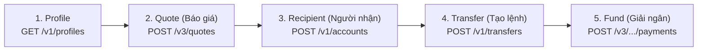

# Tài liệu Nghiên cứu & Tích hợp Wise API vào Hệ thống 11Sport POS

## 1. Tổng quan về Wise API (Wise Platform / Payouts API)

**Wise API** cung cấp hạ tầng lấy tỷ giá thực (mid-market rate), tính phí chuyển tiền quốc tế minh bạch theo từng hành lang tiền tệ (currency corridor) và tự động hóa lệnh chuyển tiền (payouts).

### 1.1. Môi trường & Base URL
| Môi trường | Base URL | Mục đích |
|---|---|---|
| **Production (Live)** | `https://api.wise.com` | Lấy tỷ giá thực, tính phí thực tế và tạo giao dịch thật |
| **Sandbox** | `https://api.sandbox.transferwise.tech` | Kiểm thử luồng tạo Profile, Quote, Recipient, Transfer mẫu |

### 1.2. Cơ chế Xác thực & Bảo mật (Authentication & Security)
1. **Unauthenticated Public Quote (`POST /v3/quotes`)**:
   - **Không bắt buộc** `Authorization` token để lấy tỷ giá mid-market thực tế (`rate`), bảng phí chi tiết (`fee.transferwise`, `fee.payIn`, `fee.total`) và thời gian nhận tiền dự kiến (`formattedEstimatedDelivery`) theo từng phương thức thanh toán (`BANK_TRANSFER`, `DEBIT`, `CREDIT`, `BALANCE`, `WIRE`...).
   - Rất phù hợp cho **Máy tính quy đổi & báo giá đổi tiền nhanh tại quầy POS**.
2. **Personal API Token / OAuth 2.0 (`Authorization: Bearer <WISE_API_TOKEN>`)**:
   - Dùng cho các endpoint gắn với tài khoản Wise của doanh nghiệp: lấy `profileId`, kiểm tra số dư ví đa tiền tệ (`balances`), tạo người nhận (`accounts`), tạo lệnh chuyển tiền (`transfers`) và giải ngân (`payments`).
3. **Strong Customer Authentication (SCA)**:
   - Đối với tài khoản đăng ký tại UK/EEA khi gọi lệnh rút/giải ngân (`POST /v3/profiles/{profileId}/transfers/{transferId}/payments`), Wise yêu cầu ký số RSA (`X-Signature` với cặp khóa Public/Private Key 2048-bit).
4. **Nguyên tắc bảo mật trên 11Sport**:
   - Tuyệt đối không đặt `WISE_API_TOKEN` ở phía trình duyệt (`web/`).
   - Toàn bộ request được gọi qua Backend proxy tại `server/src/routes/wise.ts` (`/api/v1/wise/*`).

---

## 2. Kiến trúc 5 bước chuẩn của Wise API

### Đặc thù kỹ thuật quan trọng với đồng `VND` trên Wise API:
- Wise hỗ trợ **nhận tiền bằng `VND`** (`targetCurrency = "VND"`), nhưng **không hỗ trợ gửi trực tiếp từ `VND`** (`sourceCurrency = "VND"` sẽ trả về lỗi `422 Unprocessable Entity` nếu gọi trực tiếp lên Wise).
- **Giải pháp xử lý thông minh tại `server/src/routes/wise.ts`**:
  - Khi nhân viên tại quầy nhập chiều thuận (VD: `100 USD -> VND`), hệ thống gửi nguyên bản `sourceCurrency = "USD", targetCurrency = "VND", sourceAmount = 100` lên Wise API.
  - Khi nhân viên tại quầy nhập chiều ngược từ `VND` sang ngoại tệ (VD: Khách hỏi *"Đổi 10,000,000 VND sang USD trên Wise là bao nhiêu?"*), Backend tự động đảo sang truy vấn `sourceCurrency = "USD", targetCurrency = "VND", targetAmount = 10000000` (hoặc quy đổi theo tỷ giá thực `1 / rate`), giúp lấy được chính xác **tỷ giá thực tế của Wise** và **phí chuyển Wise** cho cả 2 chiều mà không bao giờ gặp lỗi `422`.

---

## 3. Thiết kế UX/UI trên POS (`web/`) — Nút Stash Máy tính Wise

- **Vị trí & Trạng thái Stash mặc định**:
  - Một nút tròn (Floating Stash Icon hình **Máy tính** kèm huy hiệu `WISE`) mặc định nằm gọn (stashed/nép một phần vào mép phải màn hình POS để không che khuất khu vực giỏ hàng hay nút thanh toán).
  - Khi di chuột vào hoặc chạm vào trên màn hình cảm ứng/mobile, nút nhô ra mượt mà; ấn vào sẽ mở **Cửa sổ nhỏ Máy tính & Chuyển đổi tiền Wise** (Popover Mini-Window).
- **Tính năng trong Cửa sổ nhỏ (Mini-Window)**:
  1. **Máy tính bỏ túi tích hợp (+, -, ×, ÷, %)**: Nhân viên có thể bấm phép tính nhanh (VD: `150 + 75 = 225`) và dùng kết quả đó làm số tiền cần quy đổi ngay lập tức.
  2. **Quy đổi 2 chiều tức thì (Wise Live Quote)**:
     - Chọn đồng tiền gửi (`USD`, `EUR`, `GBP`, `AUD`, `SGD`, `CAD`, `JPY`, `KRW`, `THB`, `VND`...) ↔ đồng tiền nhận.
     - Nút đảo chiều (`⇄`) 1 chạm.
     - Chọn phương thức thanh toán trên Wise (`DEBIT`, `BANK_TRANSFER`, `CREDIT`, `WIRE`...) để xem phí thực tế của từng phương thức.
     - Tùy chọn cộng thêm **% Phụ phí dịch vụ tại quầy** (nếu cửa hàng thu thêm % phí đổi tiền/chuyển hộ) để ra **Tổng số tiền báo khách** chuẩn xác.
  3. **Copy nhanh báo giá & Tạo phiếu lệnh Wise**:
     - Nút **"Copy báo giá đọc/gửi khách"** định dạng rõ ràng (Số tiền, Tỷ giá Wise, Phí Wise, Thực nhận).
     - Tab **"Tạo lệnh nhanh"**: Hỗ trợ tạo nhanh lệnh chuyển tiền Wise (qua API thật nếu cấu hình `WISE_API_TOKEN` hoặc lưu phiếu báo giá Sandbox).
