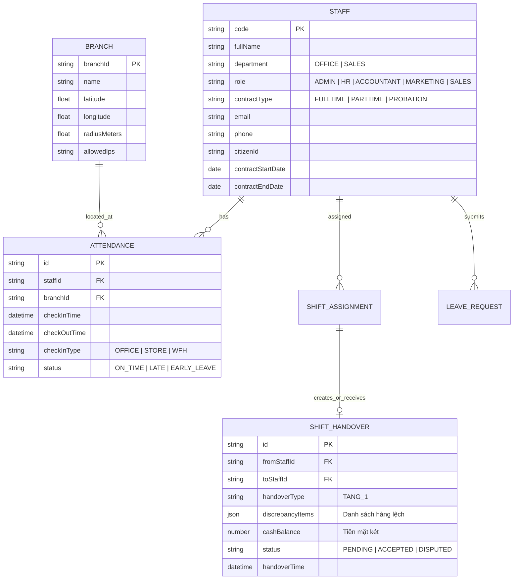

# Đặc tả yêu cầu: Hệ thống Chấm công & Quản trị Nhân sự (HRM & Shift Handover)

- **Mã tài liệu**: REQ-HRM-01
- **Phiên bản**: v1.0
- **Ngày lập**: 2026-11-05
- **Tác giả**: BA Subagent - 11 Sport
- **Trạng thái**: Đang hoàn thiện / Chờ PM & PO duyệt

---

## 1. Bối cảnh & Mục tiêu kinh doanh
Hệ thống bán hàng 11 Sport hiện có 2 khối nhân sự với đặc thù vận hành hoàn toàn khác nhau:
1. **Khối Văn phòng (Office)**: Làm việc theo giờ hành chính cố định, có nhu cầu làm việc từ xa (WFH), xin nghỉ phép, đi trễ/về sớm.
2. **Khối Bán hàng (Sales / Showroom)**: Làm việc xoay ca (ca sáng, ca chiều, ca gãy), gắn liền với quản lý tiền mặt tại quầy và bảo vệ hàng hóa tại Kho Tầng 1 (khu vực trưng bày/bán hàng).

**Mục tiêu**:
- Tự động hóa xếp ca hàng tuần dựa trên lịch rảnh của nhân viên Sales, giảm 80% thời gian HR phải xếp ca thủ công.
- Kiểm soát vị trí & kết nối mạng khi chấm công để chống gian lận.
- Chuẩn hóa quy trình giao ca tại showroom: Bàn giao Kho Tầng 1 nhanh gọn, tránh thất thoát hàng hóa.
- Quản lý tập trung hồ sơ nhân viên, ngày lễ, duyệt đơn từ qua vai trò `HR`.

---

## 2. Phạm vi (Scope)

### 2.1 Trong phạm vi (In-Scope - Phase 1)
- **Tái cấu trúc Hệ thống Vai trò (Roles & Departments)**:
  - Bỏ hoàn toàn vai trò `WAREHOUSE` (Thủ kho) cũ.
  - Thay thế bằng vai trò **`ACCOUNTANT` (Kế toán)**: Được truy cập CMS, xem Dashboard Doanh thu & Lãi gộp, tiếp quản toàn bộ nghiệp vụ Kho (tồn kho, nhập hàng, luân chuyển kho, thẻ kho) và Công nợ.
  - Quy hoạch **Khối Văn phòng (OFFICE)** gồm 3 vai trò: **`HR`** (Nhân sự), **`ACCOUNTANT`** (Kế toán), **`MARKETING`** (Content Marketing). Toàn bộ khối văn phòng áp dụng ca hành chính 08:30 - 17:30, tự dừng đồng hồ nghỉ trưa 12:00 - 13:30, và được nộp đơn làm việc từ xa (WFH). Trong đó, nhân viên `MARKETING` chỉ tham gia hệ thống để chấm công, xem hồ sơ cá nhân và nộp đơn từ; các nghiệp vụ quản lý banner, bài viết, danh mục và khuyến mãi do `ADMIN` phụ trách.
  - Quy hoạch **Khối Bán hàng (SALES)**: Vai trò **`SALES`** tại showroom áp dụng xoay 2 ca, kiểm hàng Tầng 1 và két tiền lúc bàn giao.
- **Cấu hình 2 ca làm việc chuẩn toàn công ty**:
  - **Ca 1 (Ca Hành chính / Ca Sáng)**: `08:30 - 17:30`.
  - **Ca 2 (Ca Chiều - Tối)**: `12:00 - 21:00`.
- **Cơ chế tính công & Nghỉ trưa**:
  - *Làm tròn Check-in sớm*: Được phép check-in sớm, nhưng mốc tính giờ công tự động quy về đúng giờ bắt đầu ca (`08:30` hoặc `12:00`).
  - *Chặn Về sớm*: Check-out phải đúng hoặc sau giờ kết thúc ca (`17:30` hoặc `21:00`). Bấm checkout sớm sẽ bị ghi nhận lỗi Về sớm (`EARLY_LEAVE`).
  - *Giờ nghỉ trưa (Khối Văn phòng)*: Từ `12:00` đến `13:30` đồng hồ tính giờ công tự động dừng. Giờ công thực tế = 7.5 giờ/ngày.
- **Hồ sơ nhân viên (Profile)**: Quản lý thông tin chi tiết (họ tên, CMND/CCCD, SĐT, email, loại hợp đồng, phòng ban, ngày bắt đầu, ngày hết hạn...).
- **Chấm công điều kiện kép**: Bắt buộc GPS trong bán kính quy định VÀ đúng dải IP / mạng LAN của văn phòng/cửa hàng.
- **Nghiệp vụ WFH (Khối Văn phòng)**: Đơn xin làm việc từ xa được HR duyệt -> cho phép check-in/out mọi vị trí/mạng.
- **Xếp ca thông minh (Khối Sales)**:
  - Thứ 6 hàng tuần: Nhân viên Sales checkout sẽ hiển thị màn hình đăng ký lịch bận/ngày off cho tuần kế tiếp.
  - Tự động gán ca nếu không trùng lịch; HR có giao diện kéo-thả (Drag & Drop) để xử lý ca trùng / thiếu người.
- **Kiểm hàng & Kết ca Kho Tầng 1 (Luồng gối ca 12:00 - 17:30)**:
  - 12:00: Ca 2 check-in vào làm chung showroom.
  - 17:30: Ca 1 đếm kho Tầng 1, bàn giao cho Ca 2 -> Ca 2 xác nhận -> Mở khóa nút Check-out cho Ca 1.
  - 21:00: Ca 2 đóng cửa hàng (Store Close), chốt két và gửi biên bản -> Ca 1 sáng hôm sau xác nhận khi mở cửa.
- **Lịch công & Ngày lễ**: Hiển thị lịch toàn công ty, ghi chú tên các ngày lễ bên dưới.

### 2.2 Ngoài phạm vi (Out-of-Scope - Phase 2)
- Tự động tính toán số tiền lương thực nhận (Payroll chi tiết) theo các hệ số phức tạp (chờ CEO & HR chốt quy chế lương làm ngày nghỉ/lễ).
- Chấm công bằng nhận diện khuôn mặt (FaceID / AI Camera).

---

## 3. Tác nhân hệ thống & Phân quyền CMS (Actors & Permissions)

### 3.1 Danh sách Tác nhân theo 2 Khối
- **Khối Quản trị Tối cao**:
  - `ADMIN`: Toàn quyền hệ thống, cấu hình chi nhánh, IP LAN, tọa độ GPS, phân quyền nhân sự.
- **Khối Văn phòng (OFFICE)**: Áp dụng ca 08:30 - 17:30, nghỉ trưa 12:00 - 13:30, được xin WFH.
  - `HR` (Quản trị Nhân sự): Quản lý hồ sơ nhân viên, duyệt đơn (off, trễ/sớm, WFH), cấu hình ngày lễ, kéo-thả xếp ca Sales.
  - `ACCOUNTANT` (Kế toán - *thay thế WAREHOUSE cũ*): Xem Dashboard doanh thu & lãi gộp, tiếp quản toàn bộ tính năng Kho (tồn kho Tầng 1 & Tầng 2, lập/duyệt phiếu nhập hàng, sổ kho, chuyển kho) và Quản lý Công nợ.
  - `MARKETING` (Content Marketing): Chỉ sử dụng tính năng Chấm công cá nhân, nộp đơn từ (WFH, xin nghỉ, trễ/sớm) và xem hồ sơ cá nhân. Các công việc quản trị banner, bài viết, danh mục và khuyến mãi do `ADMIN` phụ trách trực tiếp.
- **Khối Bán hàng (SALES)**: Áp dụng xoay 2 ca, kiểm hàng Tầng 1 & két tiền lúc bàn giao.
  - `SALES` (Nhân viên Showroom): Bán hàng POS, đăng ký ca làm việc Thứ 6, chấm công GPS + LAN, bàn giao ca.

### 3.2 Ma trận Phân quyền Mô-đun CMS (CMS Access Matrix)

| Mô-đun CMS | ADMIN | HR (Văn phòng) | ACCOUNTANT (Kế toán) | MARKETING (Content) | SALES (Cửa hàng) |
| :--- | :---: | :---: | :---: | :---: | :---: |
| **01. Dashboard Doanh thu & Lãi gộp (`REVENUE`)** | Toàn quyền | - | **Xem & Xuất BC** | - | - |
| **02. Quản lý Kho, Sổ kho & Nhập hàng (`INVENTORY`)** | Toàn quyền | - | **Toàn quyền (T1, T2, Nhập, Chuyển)** | - | Xem tồn Tầng 1 |
| **03. Quản lý Category / Danh mục (`CATEGORIES`)** | **Toàn quyền** | - | Xem | - | Xem |
| **04. Quản lý Đơn hàng & Đổi trả (`ORDERS`)** | Toàn quyền | - | **Xem & Tra cứu HĐ** | - | Đơn POS quầy |
| **05. Quản lý Nhân sự & Hồ sơ (`STAFF`)** | Toàn quyền | **Toàn quyền** | Xem thông tin NV | Trang cá nhân | Trang cá nhân |
| **06. Chấm công & Xếp ca (`HRM_ATTENDANCE`)** | Toàn quyền | **Toàn quyền Duyệt & Xếp ca** | Chấm công cá nhân | **Chấm công cá nhân & WFH** | Đăng ký & Bàn giao |
| **07. Chương trình Khuyến mãi (`PROMOTIONS`)** | **Toàn quyền** | - | Xem | - | Áp dụng tại POS |
| **08. Quản lý Công nợ & Thu nợ (`DEBTS`)** | Toàn quyền | - | **Toàn quyền Quản lý** | - | Thu nợ tại POS |

---

## 4. Quy tắc nghiệp vụ (Business Rules)

### 4.1 Cấu hình Ca & Tính Giờ Công
- **BR-01 (Cấu hình 2 ca chuẩn)**: Hệ thống cố định 2 khung ca làm việc:
  - **Ca 1**: `08:30 - 17:30` (9 tiếng tổng, áp dụng cho cả Khối Văn phòng và Khối Sales Ca 1).
  - **Ca 2**: `12:00 - 21:00` (9 tiếng tổng, áp dụng cho Khối Sales Ca 2).
- **BR-02 (Quy tắc làm tròn Check-in sớm)**:
  - Nhân viên được phép check-in trước giờ bắt đầu ca.
  - Tuy nhiên, thời gian bắt đầu tính công tự động làm tròn về mốc chuẩn:
    - Check-in ca 1 trước `08:30` -> Mốc tính công bắt đầu từ `08:30`.
    - Check-in ca 2 trước `12:00` -> Mốc tính công bắt đầu từ `12:00`.
    - Hệ thống không cộng dồn thời gian đi sớm vào giờ làm nếu không có đơn Overtime (OT) được duyệt.
- **BR-03 (Quy tắc Chặn Về sớm & Check-out đúng giờ)**:
  - Giờ Check-out hợp lệ bắt buộc $\ge$ giờ kết thúc ca (`17:30` đối với Ca 1, `21:00` đối với Ca 2).
  - Nếu nhân viên bấm Check-out trước mốc trên:
    - Hệ thống bật cảnh báo xác nhận về sớm.
    - Ghi nhận trạng thái `EARLY_LEAVE` kèm số phút về sớm (để HR xét duyệt trừ công hoặc phạt theo quy chế).
- **BR-04 (Giờ nghỉ trưa khối Văn phòng - Đồng hồ tạm dừng)**:
  - Khối `OFFICE` có khung nghỉ trưa cố định: `12:00 - 13:30` (1 tiếng 30 phút).
  - Đúng `12:00`, đồng hồ tính giờ công tự động tạm dừng (pause).
  - Đúng `13:30`, đồng hồ tự động kích hoạt tính tiếp mà nhân viên không cần thao tác check-out/check-in giữa giờ.
  - Tổng thời gian công thực tế được ghi nhận: $9.0h - 1.5h = 7.5$ giờ công chuẩn / ngày.

### 4.2 Chấm công & Xác thực địa điểm
- **BR-05 (Điều kiện chấm công chuẩn)**: Để Check-in / Check-out, nhân viên phải thỏa mãn 2 điều kiện:
  1. Tọa độ GPS nằm trong bán kính $R \le 50m$ của điểm làm việc.
  2. Địa chỉ IP Public mạng truy cập trùng với IP tĩnh / mạng LAN của cửa hàng/văn phòng.
- **BR-06 (Ngoại lệ WFH cho Văn phòng)**: 
  - Chỉ nhân viên khối `OFFICE` mới được tạo đơn WFH.
  - Khi đơn WFH của ngày $D$ ở trạng thái `APPROVED` bởi HR: Nhân viên được phép Check-in / Check-out ở bất kỳ đâu (bỏ qua kiểm tra GPS và LAN). Hệ thống vẫn lưu IP và GPS thực tế để phục vụ đối soát.

### 4.3 Đăng ký lịch & Xếp ca Sales (Smart Scheduling)
- **BR-07 (Pop-up đăng ký lịch bận thứ 6)**:
  - Vào Thứ 6 hàng tuần, khi nhân viên Sales bấm Check-out ca cuối cùng của ngày, hệ thống tự động bật modal: "Đăng ký ca làm việc tuần tới".
  - Nhân viên chọn: Các ngày muốn xin OFF, các ca ưu tiên (Ca 1: 08:30-17:30 hoặc Ca 2: 12:00-21:00).
  - Hạn chót nộp: 23:59 Thứ 6.
- **BR-08 (Thuật toán tự động xếp ca & Drag-and-Drop)**:
  - 00:00 Thứ 7, hệ thống chạy tự động phân bổ ca cho các nhân viên không bị trùng lịch và đủ định mức ca/tuần.
  - Các ca bị trùng (nhiều người cùng xin off một ngày, hoặc thiếu người): Đưa vào danh sách "Cần xử lý".
  - Màn hình HR: Cung cấp giao diện bảng lịch dạng Kanban/Timeline Kéo - Thả (Drag & Drop) để HR dễ dàng kéo nhân viên vào ca còn thiếu. Lịch tuần mới được chốt và công bố trước 18:00 Thứ 7.

### 4.4 Kiểm hàng Tầng 1 & Bàn giao ca Sales (Gối ca 12:00 - 17:30)
- **BR-09 (Đặc thù ca gối đầu)**:
  - Ca 1 (08:30 - 17:30) và Ca 2 (12:00 - 21:00) có khoảng thời gian gối đầu `12:00 - 17:30` (cả 2 ca cùng trực cửa hàng).
  - Lúc `12:00`: Nhân viên Ca 2 đến nơi bấm Check-in vào ca và làm việc bình thường.
  - Lúc `17:30`: Ca 1 hết giờ làm, tiến hành lập biên bản kết ca Kho Tầng 1 và chốt két tiền bàn giao cho Ca 2 (Ca 2 lúc này đã ở sẵn cửa hàng).
  - Ca 2 kiểm tra và bấm "Xác nhận nhận bàn giao" -> Nút Check-out của Ca 1 mới được mở để ra về.
- **BR-10 (Điều kiện tiên quyết kiểm tra ca)**:
  - Nhân viên ca sau **BẮT BUỘC CHECK-IN THÀNH CÔNG** thì mới được mở quyền vào màn hình "Kiểm tra bàn giao ca".
  - Nhân viên ca trước **BẮT BUỘC HOÀN TẤT KẾT CA & ĐƯỢC CA SAU XÁC NHẬN** thì nút **Check-out** mới sáng lên để bấm.
- **BR-11 (Phạm vi kiểm hàng Tầng 1)**:
  - Chỉ lấy danh sách tồn kho lý thuyết của các sản phẩm nằm tại vị trí `KHO_TANG_1` (khu trưng bày bán hàng).
  - Tối ưu thao tác: Màn hình hiển thị danh sách dạng lưới/thẻ, mặc định số lượng kiểm = tồn kho hệ thống. Nhân viên chỉ cần điều chỉnh các mã bị chênh lệch (+/-) hoặc quét barcode mã hàng lệch.
- **BR-12 (Ngoại lệ kết ca đêm 21:00 - Đóng cửa hàng)**:
  - Ca 2 kết thúc lúc 21:00 (không có ca kế tiếp trực tiếp đêm): Nhân viên gửi biên bản bàn giao kho Tầng 1 và két tiền lên hệ thống, sau đó được Check-out về.
  - Sáng hôm sau lúc 08:30: Nhân viên Ca 1 khi Check-in mở cửa sẽ là bên đối soát và xác nhận biên bản này.

### 4.5 Lịch làm việc & Ngày lễ
- **BR-13 (Cấu hình ngày lễ)**:
  - HR có màn hình Lịch (Calendar View) để thêm các ngày lễ quốc gia hoặc ngày nghỉ đặc biệt của công ty (kèm tên ghi chú: "Tết Dương Lịch", "Giỗ Tổ Hùng Vương", v.v.).
  - Ghi nhận công làm việc vào ngày lễ thành loại công riêng biệt (`HOLIDAY_WORK`) để làm căn cứ tính thưởng/hệ số sau này (Phase 2).

---

## 5. User Stories & Tiêu chí nghiệm thu (Acceptance Criteria)

### US-01: Chấm công kết hợp GPS & Mạng LAN
> Là **Nhân viên**, tôi muốn **chấm công khi đã đến nơi làm việc**, để **được ghi nhận thời gian làm việc chính xác và minh bạch**.

- **AC-01 (Check-in hợp lệ)**:
  - **Given**: Nhân viên đang ở showroom 11 Sport, GPS cách cửa hàng < 50m và đang kết nối WiFi showroom (IP khớp IP config).
  - **When**: Nhân viên bấm "Check-in".
  - **Then**: Hệ thống ghi nhận chấm công thành công, hiển thị thời gian check-in và trạng thái "Đúng giờ" (hoặc "Đi trễ X phút").
- **AC-02 (Check-in sai vị trí/mạng)**:
  - **Given**: Nhân viên đang ở ngoài đường hoặc dùng mạng 4G khác dải IP cửa hàng.
  - **When**: Nhân viên bấm "Check-in".
  - **Then**: Hệ thống chặn, thông báo lỗi: "Vui lòng kết nối đúng mạng WiFi tại cửa hàng và bật định vị GPS để chấm công".

---

### US-02: Đăng ký lịch bận và Tự động xếp ca Sales
> Là **Nhân viên Sales**, tôi muốn **chọn lịch off và ca làm việc vào Thứ 6 khi về**, để **chủ động kế hoạch cá nhân tuần sau**.

- **AC-03 (Bật popup đăng ký ca vào Thứ 6)**:
  - **Given**: Hôm nay là Thứ 6, nhân viên Sales bấm Check-out ca làm việc.
  - **When**: Modal "Đăng ký ca làm việc tuần tới" bật lên.
  - **Then**: Nhân viên tick chọn ngày bận/off, chọn ca mong muốn, bấm "Gửi đăng ký", hệ thống lưu lại và hoàn tất check-out.

---

### US-03: HR Kéo - Thả xếp ca khi có trùng lịch
> Là **HR**, tôi muốn **giao diện kéo - thả trực quan các ca làm việc**, để **xử lý nhanh chóng các ca trùng hoặc thiếu nhân sự**.

- **AC-04 (Xếp ca kéo thả)**:
  - **Given**: HR mở trang "Quản lý ca làm việc tuần tới".
  - **When**: HR kéo thẻ nhân viên từ cột "Chưa phân ca/Trùng lịch" thả vào ô "Ca Sáng - Thứ Hai".
  - **Then**: Hệ thống cập nhật lịch ca cho nhân viên đó, hiển thị cảnh báo nếu nhân viên đã quá số ca quy định trong tuần.

---

### US-04: Bàn giao Kho Tầng 1 & Mở khóa Check-out
> Là **Nhân viên Sales**, tôi muốn **quy trình giao nhận kho Tầng 1 rõ ràng giữa 2 ca**, để **không bị quy trách nhiệm oan nếu thất thoát hàng hóa**.

- **AC-05 (Chặn check-out khi ca sau chưa nhận ca)**:
  - **Given**: Nhân viên Ca trước đã tạo xong biên bản bàn giao kho Tầng 1.
  - **When**: Nhân viên Ca trước bấm nút "Check-out".
  - **Then**: Nếu Ca sau chưa bấm "Xác nhận nhận ca", hệ thống hiển thị thông báo: "Đang chờ [Tên NV Ca Sau] xác nhận nhận ca. Vui lòng đợi ca sau xác nhận để hoàn tất Check-out".
- **AC-06 (Ca sau check-in mới được kiểm tra)**:
  - **Given**: Nhân viên Ca sau chưa bấm "Check-in".
  - **When**: Cố gắng mở màn hình "Xác nhận nhận bàn giao".
  - **Then**: Hệ thống yêu cầu: "Bạn cần Check-in vào ca trước khi tiến hành nhận bàn giao kho".

---

### US-05: Làm tròn Check-in sớm & Tạm dừng Giờ nghỉ trưa
> Là **Nhân viên & HR**, tôi muốn **giờ công được tính chính xác theo mốc chuẩn của ca và tự trừ giờ nghỉ trưa**, để **không bị tính sai lệch công thực tế**.

- **AC-07 (Làm tròn Check-in sớm)**:
  - **Given**: Nhân viên được phân Ca 1 (08:30 - 17:30).
  - **When**: Nhân viên đến sớm và bấm Check-in lúc `08:05`.
  - **Then**: Hệ thống thông báo check-in thành công lúc 08:05, nhưng mốc bắt đầu tính công trong hệ thống ghi nhận là `08:30`.
- **AC-08 (Cảnh báo khi Check-out sớm)**:
  - **Given**: Nhân viên đang làm Ca 1 (kết thúc lúc 17:30).
  - **When**: Nhân viên bấm Check-out lúc `17:10`.
  - **Then**: Hệ thống hiển thị modal cảnh báo: "Bạn đang về sớm 20 phút trước khi hết ca. Bạn có chắc chắn muốn Check-out?", nếu bấm xác nhận thì lưu trạng thái `EARLY_LEAVE` kèm 20 phút về sớm.
- **AC-09 (Tự động dừng đồng hồ giờ nghỉ trưa - Khối VP)**:
  - **Given**: Nhân viên thuộc role `OFFICE` đang làm việc trong ngày.
  - **When**: Thời gian chạm mốc `12:00`.
  - **Then**: Đồng hồ tính giờ làm việc tự động tạm dừng đếm; đến `13:30` tự động tiếp tục đếm. Tổng giờ công cả ngày chốt ở mức 7.5 giờ.

---

### US-06: Xin chuyển ngày off (Đổi ngày nghỉ) cần HR duyệt
> Là **Nhân viên**, khi **đã xin off / có lịch off vào một ngày (VD: 20/11) nhưng có việc đột xuất muốn đổi sang nghỉ ngày khác (VD: 19/11)**, tôi muốn **gửi đơn xin chuyển ngày off để HR xét duyệt**, nhằm **điều chỉnh lịch nghỉ linh hoạt mà vẫn đảm bảo nhân sự trực ca và đúng quy định công ty**.

- **AC-10 (Tạo đơn xin chuyển ngày off chờ HR duyệt)**:
  - **Given**: Nhân viên đang có ngày nghỉ (`OFF` không lương, `PAID_LEAVE` phép có lương hoặc ca `OFF` trong lịch phân ca) vào ngày `20/11`.
  - **When**: Nhân viên chọn "Đổi ngày off" từ ngày `20/11` sang ngày `19/11`, nhập lý do và gửi đơn.
  - **Then**: Hệ thống tạo đơn loại `CHANGE_OFF` ở trạng thái `PENDING` (chờ HR duyệt); trong khi chờ duyệt, ngày off `20/11` vẫn giữ nguyên và không bị tính gấp đôi hạn mức nghỉ trong tháng.
- **AC-11 (HR duyệt đơn chuyển ngày off)**:
  - **Given**: Đơn `CHANGE_OFF` (từ `20/11` sang `19/11`) đang ở trạng thái `PENDING`.
  - **When**: HR bấm "Duyệt" (`APPROVED`) trên CMS.
  - **Then**: Hệ thống tự động chuyển ngày nghỉ từ `20/11` sang `19/11` (`APPROVED`), đồng thời nếu là nhân viên Bán hàng (`SALES`) thì cập nhật lịch phân ca ngày `19/11` thành `OFF` và chuyển ngày `20/11` sang ca làm việc. Nếu HR bấm "Từ chối" (`REJECTED`), lịch nghỉ cũ ngày `20/11` giữ nguyên.

---

## 6. Thiết kế Mô hình Dữ liệu (Dự kiến)

---

## 7. Đề xuất Giải pháp Tối ưu UX cho Khâu Kiểm hàng Bán hàng

| Tiêu chí | Giải pháp thông thường (Chậm) | Giải pháp tối ưu đề xuất cho 11 Sport |
| :--- | :--- | :--- |
| **Cách đếm hàng** | Bắt đếm lại toàn bộ từng chiếc áo, đôi giày trên kệ | **Nguyên tắc "Mặc định khớp"**: Hệ thống hiển thị tồn lý thuyết Tầng 1. Nhân viên chỉ điều chỉnh hoặc quét mã những sản phẩm có biến động/chênh lệch. |
| **Phân loại hàng** | Xem dàn trải toàn bộ danh mục | **Bộ lọc thông minh**: Chia tab: *Giày* (dễ lệch size), *Áo/Quần*, *Phụ kiện*. Đánh dấu sao cho *Hàng giá trị cao*. |
| **Giao tiếp 2 ca** | Viết sổ tay hoặc nhắn Zalo riêng | **Đối soát 1 chạm**: Ca sau chỉ cần lướt qua màn hình tóm tắt lệch và bấm **"Đồng ý nhận ca"** trong vòng 30 giây. |
| **Cứu cánh ca tối** | Bắt nhân viên ở lại chờ người khác | **Chế độ Chốt Đóng Cửa (Store Close)**: Cho phép ca tối chốt két, niêm phong kho và Check-out về luôn, ca sáng hôm sau xác nhận. |

---

## 8. Kế hoạch bước tiếp theo (Next Steps)
1. Chuyển thông tin cho **PM** để cập nhật Roadmap và phân bổ Sprint.
2. Bàn giao cho **Designer**: Thiết kế UI Mobile Check-in, Màn hình Pop-up đăng ký ca T6, Giao diện Kéo-thả (Drag & Drop) xếp ca cho HR, Màn hình Biên bản bàn giao Tầng 1.
3. Bàn giao cho **Backend-Dev**: Bổ sung schema `Staff` (Role HR, Contract), tạo các bảng `Attendance`, `Shift`, `ShiftHandover`, `Holiday`, cập nhật `docs/api-contract.md`.