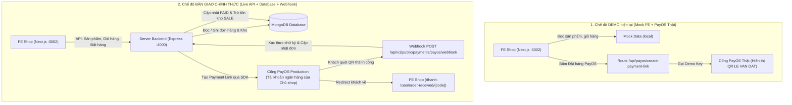

# Hướng dẫn chuyển đổi từ Mock Data sang API Thật & Vận hành PayOS Production

> **Mã tài liệu:** `shop/docs/plan/migration-from-mock-to-live-api.md`  
> **Áp dụng cho:** Dự án 11 Sport Storefront (`shop/`) & Backend (`server/`)  
> **Mục đích:** Cung cấp quy trình từng bước rõ ràng để lập trình viên chuyển toàn bộ hệ thống từ trạng thái Mock Data sang hoạt động chính thức với Backend API thật và cổng thanh toán PayOS thật khi bàn giao dự án.

---

## 1. Tổng quan cơ chế hoạt động hiện tại vs Hoạt động chính thức



---

## 2. Các bước chuyển đổi chi tiết khi bàn giao

### Bước 1: Kích hoạt chế độ Live API trên Frontend (`shop/`)

1. Mở file [shop/.env.local](file:///Users/mac/Project/FE_sport/shop/.env.local) (hoặc cấu hình biến môi trường trên Vercel/Hosting).
2. Thêm hoặc sửa biến:
   ```env
   # Chuyển từ mock sang api
   NEXT_PUBLIC_DATA_SOURCE=api
   
   # Trỏ về địa chỉ server Backend thật
   NEXT_PUBLIC_API_URL=http://localhost:4000/api/v1
   # (Khi deploy production: NEXT_PUBLIC_API_URL=https://api.ten-mien-cua-ban.com/api/v1)
   ```

> [!NOTE]
> Khi `NEXT_PUBLIC_DATA_SOURCE=api`, hàm `isMockApiEnabled()` trong [shop/src/lib/api.ts](file:///Users/mac/Project/FE_sport/shop/src/lib/api.ts) sẽ tự động trả về `false`. Toàn bộ các yêu cầu từ trang chủ, danh mục, chi tiết sản phẩm, giỏ hàng, tra cứu đơn đến đặt hàng đều sẽ gọi trực tiếp đến Backend Express server mà không cần sửa bất kỳ file Component nào.

---

### Bước 2: Dọn dẹp mã Mock (Tùy chọn)

- Khi `NEXT_PUBLIC_DATA_SOURCE=api`, toàn bộ code trong `shop/src/data/mock/` và `shop/src/repositories/mock/` sẽ **hoàn toàn không được gọi đến**.
- Bạn có thể **giữ lại** thư mục này để phòng khi cần bật lại chế độ offline demo (`NEXT_PUBLIC_DATA_SOURCE=mock`), hoặc xóa bỏ nếu muốn làm sạch mã nguồn trước khi bàn giao cho khách hàng.

---

### Bước 3: Cấu hình Khóa PayOS Thật của Cửa hàng trên Backend (`server/`)

Để tiền thanh toán từ khách chuyển thẳng vào tài khoản ngân hàng thực tế của chủ shop (thay vì tài khoản demo `LE VAN DAT`):

1. **Đăng ký tài khoản PayOS:**
   - Truy cập [https://my.payos.vn](https://my.payos.vn) để đăng ký tài khoản.
   - Liên kết tài khoản ngân hàng của doanh nghiệp/chủ cửa hàng 11 Sport.
2. **Lấy bộ 3 thông số bí mật:**
   - Vào mục **Cài đặt tích hợp** trên PayOS Dashboard.
   - Sao chép 3 giá trị:
     - `Client ID`
     - `Api Key`
     - `Checksum Key`
3. **Cập nhật vào file `server/.env`:**
   Mở file [server/.env](file:///Users/mac/Project/FE_sport/server/.env) trên máy chủ:
   ```env
   # Thay thế bằng bộ 3 khóa thật nhận được từ PayOS Dashboard
   PAYOS_CLIENT_ID=dia_chi_client_id_that_cua_chu_shop
   PAYOS_API_KEY=dia_chi_api_key_that_cua_chu_shop
   PAYOS_CHECKSUM_KEY=dia_chi_checksum_key_that_cua_chu_shop
   ```
4. **Cập nhật Webhook URL trên PayOS Dashboard:**
   - Trên trang quản trị PayOS, tìm mục **Webhook URL** và điền địa chỉ:
     `https://<domain-backend-cua-ban>/api/v1/public/payments/payos/webhook`
   - Bấm **Xác nhận Webhook**. Backend 11 Sport đã tích hợp sẵn endpoint này và sẽ trả về xác nhận ngay lập tức.

---

### Bước 4: Kiểm tra luồng hoạt động tự động của Backend

Khi chạy với Backend thật:
1. **Khách đặt hàng:**
   - Frontend gửi `POST /api/v1/public/orders` sang Backend.
   - Backend tính giá, giữ chỗ kho 15 phút, sinh số nguyên `payosOrderCode` và gọi SDK PayOS tạo link thanh toán.
   - Backend lưu đơn hàng vào MongoDB với trạng thái ban đầu: `paymentStatus: "UNPAID"`, `fulfillmentStatus: "PENDING"`.
2. **Khách quét mã QR trên PayOS:**
   - Tiền về tài khoản ngân hàng của chủ shop.
   - PayOS lập tức gửi thông báo Webhook về: `POST /api/v1/public/payments/payos/webhook`.
   - Backend tự động:
     - Dùng SDK kiểm tra chữ ký điện tử an toàn.
     - Tìm đơn hàng theo `payosOrderCode`.
     - Cập nhật đơn hàng thành `PAID` và `fulfillmentStatus: "CONFIRMED"`.
     - Ghi nhận phiếu xuất kho `StockMovement SALE` (trừ tồn kho chính thức).
3. **Trải nghiệm khách hàng:**
   - PayOS tự động chuyển khách về trang `/thanh-toan/order-received/{code}?status=PAID`.
   - Màn hình tự động hiển thị: **"Đã thanh toán thành công"** mà khách không cần làm thêm bất kỳ thao tác nào.

---

## 3. Bảng Checklist kiểm tra trước khi bàn giao

| Bước | Hạng mục kiểm tra | Trạng thái đạt yêu cầu | Ghi chú |
| :---: | :--- | :---: | :--- |
| 1 | File `shop/.env.local` | `NEXT_PUBLIC_DATA_SOURCE=api` | Tắt mock data, kết nối backend thật |
| 2 | File `server/.env` | Điền đủ 3 khóa PayOS thật | Tiền về đúng tài khoản ngân hàng |
| 3 | PayOS Dashboard | Cài đặt Webhook URL chính xác | Nhận thông báo thanh toán tự động |
| 4 | Test tạo đơn hàng | Mở link thanh toán PayOS thành công | Hiển thị đúng tên tài khoản chủ shop |
| 5 | Test quét tiền thật | Quét 10.000đ từ app ngân hàng | Đơn tự động đổi sang "PAID" và trừ kho |
| 6 | Test hủy thanh toán | Bấm "Hủy thanh toán" trên PayOS | Quay về trang checkout an toàn |
