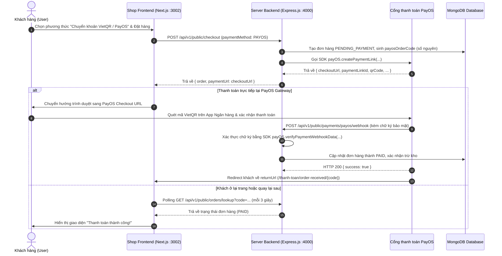

# Kế hoạch tích hợp cổng thanh toán PayOS (Config-Driven)

> **Mã tài liệu:** `shop/docs/plan/payos-integration-plan.md`  
> **Người lập:** AI Assistant (Phụ trách Fullstack & Documentation)  
> **Ngày lập:** 24/11/2026  
> **Trạng thái:** Đã duyệt bởi User (Approved)  

---

## 1. Mục tiêu & Yêu cầu bài toán

1. **Tích hợp cổng thanh toán trực tuyến PayOS vào hệ thống 11 Sport**:
   - Cho phép khách hàng thanh toán quét mã QR VietQR động / Thẻ qua cổng PayOS an toàn.
   - Trạng thái thanh toán tự động cập nhật theo thời gian thực (Real-time Webhook).
   - Tự động trừ tồn kho và xác nhận đơn khi giao dịch thành công.
2. **Nguyên tắc Config-Driven (Cắm là chạy)**:
   - Tích hợp sử dụng bộ key demo trong cấu hình môi trường `.env`.
   - Khi chuyển sang môi trường Production (tiền thật về tài khoản ngân hàng của chủ shop), chỉ cần thay thế 3 thông số bí mật trong `.env` (`PAYOS_CLIENT_ID`, `PAYOS_API_KEY`, `PAYOS_CHECKSUM_KEY`) mà không cần sửa bất kỳ dòng mã nguồn nào.
3. **Cấu trúc lưu trữ tài liệu bảo trì (`shop/docs/`)**:
   - `shop/docs/plan/`: Lưu kế hoạch thực hiện task (file này).
   - `shop/docs/log/`: Ghi log chi tiết AI làm gì, sửa những đoạn code nào (trích dẫn code trước/sau, giải thích chi tiết) để tiện theo dõi và bảo trì.
   - `shop/docs/tree/`: Cây thư mục thể hiện các file thay đổi / tạo mới phục vụ task.

---

## 2. Thông tin tài khoản Demo & Cấu hình

Bộ thông số Demo chuẩn PayOS:
- **Client ID:** `e9f36b27-df3f-4012-82fd-37d5df09692d`
- **Api Key:** `27764fd4-63d8-48c2-a258-0e590594f5b3`
- **Checksum Key:** `d25fc5776b685117af343800df1d872d46b19f94d0953de6a6cc40bf19b3d94a`
- **Cổng thanh toán:** PayOS Sandbox / VietQR Gateway.

---

## 3. Kiến trúc & Luồng hoạt động (Sequence Diagram)

---

## 4. Các ràng buộc kỹ thuật cốt lõi của PayOS

1. **`orderCode` (Mã đơn hàng PayOS)**:
   - Phải là **số nguyên dương** (`integer`) trong khoảng `1` đến `9007199254740991` (`Number.MAX_SAFE_INTEGER`).
   - Không được dùng chuỗi ký tự (như `"DH-173245"`). Cần sinh `payosOrderCode` duy nhất dựa trên timestamp + số ngẫu nhiên hoặc sequence.
   - Thêm trường `payosOrderCode` vào schema `Order` trong MongoDB và đánh index.
2. **`description` (Nội dung chuyển khoản)**:
   - Tối đa 25 ký tự.
   - Không chứa dấu tiếng Việt, không chứa ký tự đặc biệt (chỉ gồm chữ cái không dấu, số, khoảng trắng).
   - Ví dụ format: `11S <payosOrderCode>`.
3. **Webhook Verification**:
   - Dùng phương thức chuẩn của SDK `@payos/node`: `payos.verifyPaymentWebhookData(webhookBody)` để tránh lỗi tính toán sai signature HMAC SHA256 khi thứ tự key JSON bị xáo trộn.
   - Idempotency: Kiểm tra nếu đơn hàng đã được cập nhật `PAID` thì bỏ qua xử lý trừ kho lặp lại.

---

## 5. Danh sách các bước triển khai chi tiết

### Giai đoạn 1: Backend (`server/`)
1. Cài đặt thư viện chính thức `@payos/node`.
2. Khai báo các biến môi trường trong `server/.env` và `server/.env.example`.
3. Cập nhật Model `server/src/models/Order.ts`: Thêm trường `payosOrderCode?: number` (index: true).
4. Tạo Service chuẩn `server/src/services/payos.service.ts`:
   - Khởi tạo instance PayOS với cấu hình từ `.env`.
   - Hàm `createPaymentLink`: tạo link thanh toán, xử lý description chuẩn < 25 ký tự.
   - Hàm `verifyWebhookData`: kiểm tra chữ ký webhook an toàn.
5. Cập nhật `server/src/services/webStockAndPricing.ts`:
   - Kết nối logic tạo link thanh toán với hàm `createPayosOrVietQrPayment`.
6. Cập nhật `server/src/routes/publicStorefront.ts`:
   - Endpoint `POST /checkout`: Sinh và lưu `payosOrderCode`, gọi service PayOS và trả về `paymentUrl`.
   - Endpoint `POST /payments/payos/webhook`: Xác thực webhook payload qua SDK, tìm đơn bằng `payosOrderCode` hoặc `orderCode`, cập nhật trạng thái `PAID` và kích hoạt trừ tồn kho.
7. Cập nhật tài liệu hợp đồng `docs/api-contract.md` theo quy tắc dự án.

### Giai đoạn 2: Frontend (`shop/`)
1. Cập nhật `shop/src/components/checkout/CheckoutClient.tsx`:
   - Khi người dùng đặt hàng với phương thức `PAYOS` và backend trả về `paymentUrl`, tự động chuyển hướng khách hàng sang cổng thanh toán PayOS.
2. Cập nhật `shop/src/components/checkout/OrderSuccessClient.tsx`:
   - Bổ sung cơ chế auto-polling: Gọi API lookup đơn hàng mỗi 3 giây nếu đơn đang ở trạng thái chờ thanh toán.
   - Khi nhận trạng thái `PAID` từ webhook, giao diện tự động chuyển trạng thái hoàn tất mà không cần khách F5 lại trang.

### Giai đoạn 3: Tài liệu & Kiểm thử
1. Ghi chi tiết log thay đổi vào `shop/docs/log/payos-integration-log.md`.
2. Ghi cây thư mục các file vào `shop/docs/tree/payos-changed-files.md`.
3. Kiểm tra build TypeScript toàn dự án (`server` và `shop`).
